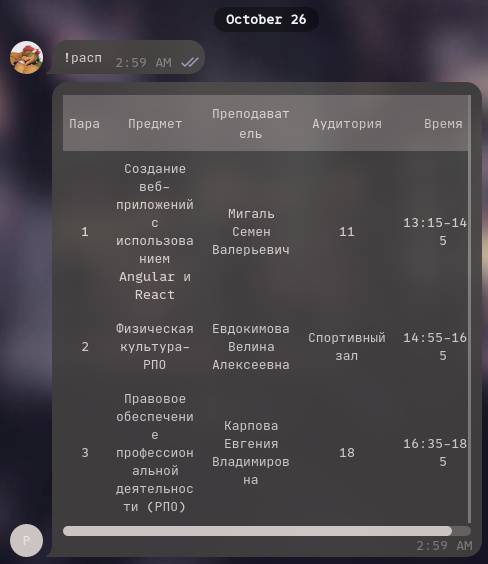

# бот расписания для колледжа IT TOP Academy
примитивно простой телеграм-бот, который парсит расписание из бетки нового журнала. основано на реалиях филиала в новороссийке

НЕ НАВАЙБКОЖЕНО‼️‼️‼️

## как работает
- входим от лица юзера
- парсим access jwt-токен и сохраняем его (чтобы не ебать мозги москве, сессия живет 6 часов)
- по команде `!расп` получаем расписание и отправляем красивой табличкой из последних апдейтов телеги

## пример

## майлстоуны
ну вот чтоб по красоте было, еще планируется:
- переход на отдельный апи-враппер ЛИБО rewrite in golang (а может, и то, и то вместе)
- парсинг не только группы того юзера, от которого он производится
- мейби, что-то еще ¯\_(ツ)_/¯

## запуск
сперва: создаем .env и пишем туда значения из .example.env

варианта два. первый: `npm install && node --env-file .env index.ts`. второй: `docker compose up -d --build`

## лицензия и отказ от ответственности
софт предоставляется "как есть" и автор не предоставляет никаких гарантий ни на что. если что-то не работает — допиливайте, код вам доступен ¯\_(ツ)_/¯

полный текст лицензии в [LICENSE](LICENSE)